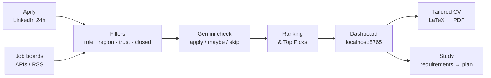

# Job Tracker

**A local job radar for remote developers in Brazil / LATAM.** It finds fresh remote dev jobs that
are actually open to you, throws out the junk, tailors your CV to each one, and turns the jobs you
like into a study plan. It runs on your own machine, with your data in a SQLite file.

> Built for one person's job hunt (mid-level Python / TypeScript / React / LLM), but every filter,
> search and keyword lives in `config.json`.

## What it does

- 🔎 **Fresh jobs, not stale reposts.** LinkedIn jobs from the last 24h, through an Apify scraper so
  your IP never gets rate-limited. Jobs also come from Himalayas, Remote OK, We Work Remotely, Remotive and
  Greenhouse / Lever / Ashby boards.
- 🌎 **Remote that is open to you.** Reads each description and hides "remote (US only)", "must
  reside in Canada" and "authorized to work in the US". Jobs that hire in Brazil / LATAM / worldwide get a
  **Brazil OK** tag.
- 🧹 **Junk filter.** Scores trust (spam phrases, agencies, AI-training gig mills, mass reposts,
  closed jobs). Gemini then reads each survivor next to your CV and says *apply / maybe / skip*, with a
  0–100 score.
- 🏆 **Ranked for your odds.** Your skills, mid-level fit, startup, Easy Apply, few applicants and
  freshness. **Top Picks** shows the best 5.
- 📄 **CV tailored per job, without inventing anything.** It reorders and rewords your own bullets
  for the posting and compiles a one-page PDF. Every bullet is checked: no new numbers, no new
  technologies, no inflated roles. Portuguese postings get a Portuguese CV.
- ✅ **Step-by-step card.** 1 Tailor CV → 2 Open & apply → 3 Applied. Only the next step is highlighted.
- 📚 **Study plan from real jobs.** Bookmark jobs you like and see the requirements they share
  ("RAG 3/3, not in your CV"). It builds a plan with topics in order, a hands-on exercise for each, and
  a portfolio project that covers them.
- 💸 **Costs you can see.** A Costs page with the month's Apify spend, the projection and every run,
  plus a hard monthly budget.
- 🔔 Windows notifications when good jobs land.

## How it fits together



**Stack:** Python 3.12, FastAPI, Jinja + htmx (no build step), SQLite, Google Gemini (`google-genai`),
Tectonic for LaTeX, Apify for LinkedIn. It is set up for Windows (notifications, `run.bat`), but the
core runs anywhere.

## Quick start

```
git clone https://github.com/K3yg/linkedin-tracker && cd linkedin-tracker
copy .env.example .env        # GEMINI_API_KEY, APIFY_TOKEN, PROFILE_ABOUT, CV_NAME
mkdir cv && copy <your CV>.tex cv\base.tex
run.bat                       # http://localhost:8765
```

Needs [uv](https://docs.astral.sh/uv/). For PDFs, put `tectonic.exe` in `tools/`. Without an Apify
token, set `apify.enabled: false`: LinkedIn is then read through its public logged-out pages, which
get rate-limited quickly. Without a Gemini key, the AI check, tailoring and Study are off; everything
else works.

Other commands:

```
uv run python -m app.poller  # one scan from the terminal, prints new jobs (--list, --notify)
schtasks /create /tn "Job Tracker" /sc onlogon /tr "\"%CD%\run.bat\""   # start at logon
```

**What's private:** `.env`, `cv/`, `data/` and `intel/` are git-ignored, so your CV, keys and job
history never leave your machine. The only data that goes out: the job text and your CV body go to
Gemini, and the search keywords go to Apify.

**Typical cost:** Apify is about US$0.05 per run (about US$1.50/month at 1 run a day; free credit is
US$5/month). Gemini is under a cent per tailored CV or analysed job, and about US$0.02 per study plan.

---

## How a scan works

1. Search each query (with "remote" appended) for jobs posted since the last scan.
   Titles must pass the software-dev filter (`role_keywords` / `exclude_title_words`).
2. For up to `detail_checks_per_scan` jobs, read the detail page: applicants, description,
   seniority, employment type, industry, company page, Easy Apply vs external, salary.
   Best bets go first: fresh, not senior, one copy per company + title, not from a blocked company.
   Company pages (size → "Startup") are optional: when LinkedIn refuses them (HTTP 999) they pause
   for 6h instead of failing the scan.
3. Classify remote / not remote from the description (`classify_workplace` in `app/scraper.py`).
   Then where it can be done from (`app/region.py`): "remote within the US", "must reside in Canada",
   "authorized to work in the United States" are hidden; Brazil / LATAM / worldwide get a **Brazil OK** tag
   and rank first; postings that don't say get a **Region?** tag and rank lower.
4. Score trust (`app/trust.py`): blocked companies, spam phrases, agencies, repeat postings…
   Suspicious jobs move to the **Flagged** tab with the reasons.
5. Drop jobs that are **no longer accepting applications** (LinkedIn's banner or the description
   saying so). A few To Apply jobs are re-read each scan (`rechecks_per_scan`) so closed ones drop out.
6. **AI check** (`app/ai.py`, Gemini): each job that passed every rule is read next to your CV
   (`cv/base.tex`) and judged apply / maybe / skip with a 0–100 score and reasons (hover the
   **AI 85** tag). Skips move to Flagged; the score feeds the ranking. Backfill now with
   `uv run python -m app.ai 50`.
7. Write `intel/latest.md`, `intel/scans/<time>.md` and `intel/jobs.jsonl`.

## LinkedIn via Apify (`app/apify.py`) — paid, the default

LinkedIn blocks this PC's logged-out requests, so LinkedIn jobs come from the Apify actor
`bebity/linkedin-jobs-scraper` (set `APIFY_TOKEN` in `.env`). While `apify.enabled` is on, the tracker
sends LinkedIn **no requests at all**. Each run returns remote jobs from the last 24h with the description,
applicant count and apply type, so they go straight to To Apply.

- About US$0.001 per job plus a small fee per run. `every_minutes` (480 = 3 runs/day), `rows` and
  `max_usd_per_run` (enforced by Apify) keep it at a few dollars a month.
- `monthly_budget_usd` (default 4.00, under the free US$5 credit) skips any run that could cross it. The
  check uses the larger of the tracker's own runs and Apify's account usage.
- The very first run waits for **Scan Now**; after that it runs on the interval.
- **Costs** (top toolbar, or the US$ chip in the title bar) shows the month's spend, the projection, the
  Apify account usage and every run.
- Test the mapping for free: `uv run python -m app.apify --from-file dataset.json`.

## Other job boards (`app/sources.py`)

LinkedIn rate-limits logged-out traffic, so jobs also come from boards with public APIs / RSS, each
checked hourly on its own loop (a LinkedIn backoff doesn't hold them up):

- **Himalayas** — searched with `country: Brazil`, so every result hires in Brazil (or worldwide)
- **Remotive** (every 6h, as it asks), **Remote OK**, **We Work Remotely** (RSS categories)
- **Greenhouse / Lever / Ashby** — company job boards; add the company's board name
  (`boards.greenhouse.io/<name>`, `jobs.lever.co/<name>`, `jobs.ashbyhq.com/<name>`), remote postings only

They arrive with the full description, go through the same title / trust / region / seniority filters,
and show the board's name where LinkedIn jobs show the applicant count. Apply on their site.

## Tailored CVs

Click **Tailor CV** on a job (To Apply or Applied). In ~20s it shows **CV PDF ↗**, the `.tex`, and
**What changed** (headline before/after, each bullet's new position and wording with the original
underneath, what was dropped and why). Upload the PDF in Easy Apply, then click Applied — the CV stays
on the job.

How it works (`app/tailor.py`): Gemini (`ai.tailor_model`) reorders and rewords the bullets of
`cv/base.tex` for the posting; the `.tex` is rebuilt from your file, so header, contact details,
companies, titles and dates never pass through the AI. Each bullet is checked: it must come from one of
your bullets in the same job, with no new numbers or technologies, no inflated role ("contributed to" →
"led"), and not much longer. Problems get one retry, then your original wording is kept. Portuguese
postings get a Portuguese CV. Compiled by `tools/tectonic.exe` (downloaded from its GitHub releases)
and kept to one page. Files: `cv/out/<job id>/`. To update your CV, replace `cv/base.tex`.

## Study (`app/study.py`)

The bookmark on any job (any tab) marks it for the **Study** page. It doesn't move the job, and a
marked job is never deleted by a reset or the stale-job cleanup.

- **Marking** has Gemini list that job's requirements once (skills, tools, AI techniques, practices),
  each marked as in your CV or not. They're stored on the job and never asked again.
- **The Study page** counts those requirements across the bookmarked jobs, with no AI call, so you see
  what keeps coming up (e.g. "Prompt Evaluation 4/6, not in CV").
- **Build study plan** sends the counted requirements and your CV to Gemini once. You get topics in
  the order to learn them, plus 1–2 portfolio projects that cover them. The plan is saved for that
  exact set of jobs: asking again shows the saved plan, unless you press Rebuild.

The model is `ai.study_model`, falling back to `ai.tailor_model`. Costs about US$0.005 per job and
US$0.01 per plan.

## Intelligence files (`intel/`)

- `latest.md` — what the last scan found + an overview of the whole dataset + your labels.
  Paste it into an AI (instructions at the bottom of the file) to learn what a good job looks
  like for you and get better keywords / filter rules.
- `jobs.jsonl` — one JSON object per job: structured fields, remote evidence, trust flags,
  a description excerpt and `my_label` (applied / dismissed / unreviewed).

## Scout run

```
uv run python -m app.scout            # broad, unfiltered search -> data/scout.db, intel/scout/
```

Use it to study what spam looks like before adding rules; your real data is untouched.

## Configure — `config.json`

- `searches`: keywords + optional location (also editable from the dashboard)
- `remote_only`: show/notify only jobs verified as remote
- `easy_apply_only`: only Easy Apply jobs (searches send LinkedIn's `f_AL=true`, the list hides the rest)
- `ai`: `enabled`, `model` (default `gemini-2.5-flash`), `per_scan`, `hide_skips`. Needs `GEMINI_API_KEY`
  in `.env` (not committed; copy `.env.example`), plus `PROFILE_ABOUT` (one-line summary of you for the AI)
  and `CV_NAME` (tailored PDF file name). Your CV goes in `cv/base.tex`, also not committed.
- `remote_region`: `allowed` regions you can work from (Brazil, LATAM…); `hide_unstated: true` also hides
  remote jobs that don't say where they hire
- `poll_minutes`, `max_pages_per_search` (10 jobs/page), `detail_checks_per_scan`, `lookback_seconds`.
  Detail reads go to jobs posted in Brazil first, then Latin America (where remote jobs are open to you);
  LinkedIn jobs still unread after 3 days are dropped. A rate-limit backoff survives restarts
  (`data/poller_state.json`).
- `email_alerts`: read LinkedIn's job-alert emails over IMAP (read-only) so finding jobs costs no
  LinkedIn request. Create alerts on LinkedIn (logged in, so its Remote filter works), put
  `IMAP_USER` / `IMAP_PASSWORD` in `.env` (Gmail: an app password), set `enabled: true`. `mailbox`
  is the folder or Gmail label holding them (`INBOX` by default). While alerts work, the LinkedIn
  search only runs every `search_minutes` (180); detail reads keep the `poll_minutes` pace.
  Check what it reads: `uv run python -m app.mail_alerts`.
- `sources`: the other job boards above (`every_minutes`, `max_age_days`, per-board settings)
- `notify_only_open`: notify only for jobs open to Brazil / worldwide (the rest still show)
- `role_keywords` / `exclude_title_words`: the software-dev title filter
- `profile`: your skills (`skills` +points, `avoid` −points) and `min_fit`; jobs below it are hidden.
  Ranking ("Best match") = fit + open to Brazil + startup (company size from LinkedIn) + mid-level
  ("Engineer II", "Mid", "Pleno", asks 2–5 years) − senior (less if it only asks ≤ 5 years)
  + Easy Apply + few applicants + fresh. The same role posted in several cities shows once ("+N more").
- `top_picks_exclude_title_words`: keep these titles out of Top Picks (e.g. staff, principal)
- `trust`: `blocked_companies`, `trusted_companies`, `hide_phrases` (hide on sight),
  `warn_phrases` (soft), thresholds. The dashboard's Block / Trust company buttons edit these.

## Limits of the logged-out endpoints

- LinkedIn ignores its own remote filter when logged out, so remote-ness is inferred from the
  job description. Postings that only mark "Remote" in LinkedIn's UI badge without saying it in
  the text are classified "unknown" and hidden.
- When LinkedIn refuses (HTTP 429 or 999), asking again keeps the block going, so LinkedIn is
  paused entirely (Scan Now included) for 24h, then tried once; another refusal means another 24h.
- Every scan's requests and the block that ended it go to `data/ratelimit_log.jsonl`; see which
  request kind gets refused, how many requests in and at what hour: `uv run python -m app.ratelimits`.

Data lives in `data/jobs.db` (SQLite).
